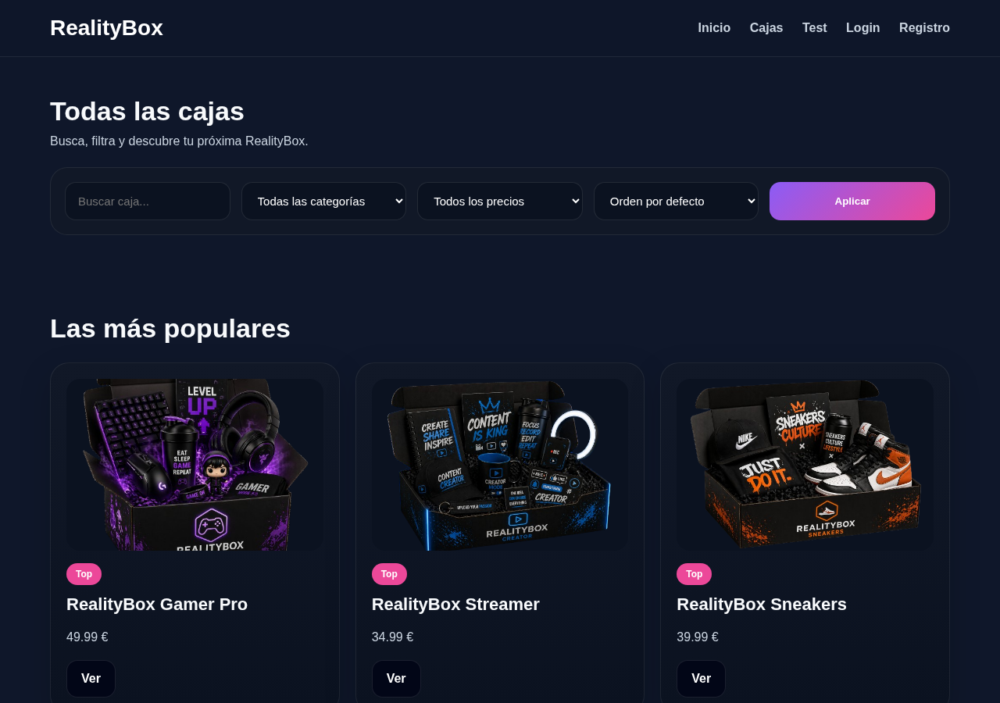

# RealityBox

Tienda simulada de cajas sorpresa en Laravel. Explora el catálogo, abre una caja con saldo ficticio y conserva el premio en el inventario. El panel de administración permite gestionar los productos.



## Instalación

Necesitas PHP 8.2 o superior con PDO SQLite y las extensiones de Laravel, Composer 2, y Node.js 22.12 o superior. Desde una copia limpia, ejecuta en Bash:

```sh
cd DeployApp
composer install
cp .env.example .env
php artisan key:generate
php -r "file_exists('database/database.sqlite') || touch('database/database.sqlite');"
php artisan migrate --seed
npm ci
npm run build
php artisan serve
```

Abre `http://127.0.0.1:8000`. El ejemplo usa SQLite y crea dos cuentas ficticias en el entorno local. La carga de datos de usuarios conserva las cuentas existentes al repetirla.

## Probar catálogo, inventario y administración

1. Entra en **Catálogo** y abre el detalle de una caja.
2. Inicia sesión con `test@realitybox.local` y contraseña de demo `1234`. Dispones de 250 € ficticios.
3. Abre una caja, elige **Quedármelo** y visita **Inventario**. El premio debe aparecer como guardado y el saldo debe reducirse en el precio de la caja.
4. En un navegador o sesión aparte, entra con `admin@realitybox.local` y la misma contraseña de demo. Visita `/dashboard` y comprueba que tienes la opción de crear un producto. Un usuario sin rol de administración recibe un 403.

Las cuentas de ejemplo están destinadas a instalaciones locales. Puedes ejecutar las pruebas existentes con `php artisan test`.

- [Captura del inventario después de guardar el premio](docs/inventario.png)
- [Captura del panel de administración](docs/administracion.png)
